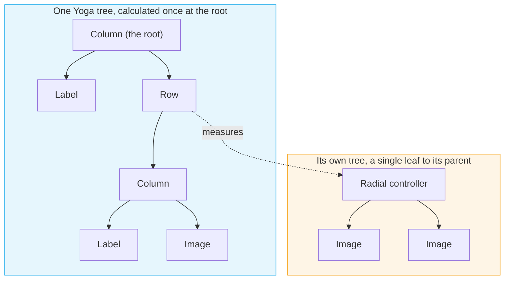
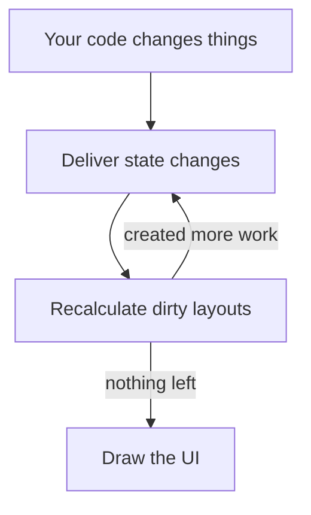

## Controllers and modifiers

Reactive separates what a container holds from how it's arranged. A container holds children, a separate object called
its **controller** places them, and each child describes how it wants to be placed through its own **modifier**. Flexbox,
through Meta's Yoga, is the controller that ships with the library, but nothing in the model depends on it.

Here's a typical layout that sets both:

```csharp
new Layout {
    FlexController = {
        FlexDirection = FlexDirection.Column,
        AlignItems = Align.Center,
        Gap = 2.pt
    },

    FlexItem = {
        Size = new() { x = 40.pt }
    },

    Children = { ... }
}
```

`FlexController` is about the layout's children, and here it stacks them in a column, centers them and leaves a gap.
`FlexItem` is about the layout inside its parent, and here it asks for forty points of width. Everything you'd put on a
flex container in CSS lives on the controller, such as `JustifyContent`, `AlignItems`, `FlexWrap`, `Padding` and `Gap`.
Everything you'd put on a flex item lives on the modifier, such as `Size`, `Flex`, `Margin`, `Position` and `AlignSelf`.
Both are plain objects with settable properties, so every property can be bound to a state. A controller is a row unless
told otherwise, like on the web, and [Flexboxes](/docs/reactive/layout/yoga) goes through the rest.

Both objects are created the first time you touch them, so a container that never uses layout never creates a Yoga node.
The flip side is a trap: `FlexController = { }` with nothing inside never runs the getter, so it creates nothing. Set at
least one property, or use `.AsFlexGroup()` and `.AsFlexItem()`, which take the same properties as optional arguments.
`FlexController` is a shorthand for `LayoutController = new YogaLayoutController()`, and `LayoutController` accepts any
`ILayoutController`, as [Your own Layout Controller](/docs/reactive/layout/custom) explains.

The next rule differs from the web. In Yoga, as in a browser, every node is a container and an item at the same time. In
Reactive, **a container without a controller doesn't lay out its children at all**, so they keep whatever rect they have
and nobody reads their modifiers.

This label isn't laid out, because the background around it has no controller:

```csharp
new Background {
    Children = {
        new Label {
            Text = "Hello"
        }
    }
};
```

<Screenshot src="/assets/layout/containers-1.png" alt="A blue background at Unity's default 100 by 100, spilling past the top and bottom of its orange parent" />

In these images, the orange panel is the parent and the blue one is the background. The background sits at Unity's
default 100 by 100 and spills past its parent, and the label is wherever its own rect happened to be. Nothing is broken,
since nothing was asked to lay anything out.

Give the background a controller, even with a single property set, and both snap into place, as this version shows:

```csharp
new Background {
    FlexController = {
        JustifyContent = Justify.Center
    },

    Children = {
        new Label {
            Text = "Hello"
        }
    }
};
```

<Screenshot src="/assets/layout/containers-2.png" alt="The blue background filling its orange parent exactly, with the label centered" />

This lets you mix laid-out content with things you position by hand, like a knob you drag around or a native Unity object
with its own anchoring. It also means the layout engine costs nothing for the parts of a screen that don't need it. In
practice, `FlexItem` on a child only means something if the parent has a `FlexController`, so check that first if a size
you set is being ignored.

## Leaves and roots

Two kinds of component sit at the edges of this model, and knowing which is which explains most sizing behaviour.

A **leaf** has intrinsic content and no children, so a `Label` is as big as its text and an `Image` as big as its sprite.
It has no controller, and instead measures itself when the parent's controller asks. A label in a column takes exactly the
room its text needs, grows when the text changes, and never needs a `Size` unless you want to force one. A leaf's
`FlexItem` can still set a size, a flex or a margin, and the parent honours those over the measured size.

So any component plays one of three roles. A container with a controller is sized by its children, its own modifier and
its parent. A leaf is sized by measuring its content, its modifier and its parent. Anything else, such as a `Background`
without a controller, measures as empty and is sized by its modifier and parent alone. A component is a container or a
leaf, never both, so a `Background` takes its size from what's inside it rather than from its sprite. Use an `Image` for
a box exactly the size of a sprite, and see [Component Internals](/docs/reactive/under-the-hood/component#the-layout-component)
to write a leaf of your own.

A **root** is a layout that nobody lays out, like the top of a screen or anything whose parent has no controller. With no
controller above to give it a size, it's sized against the rect of the transform it's attached to. A root under a view
controller fills the view without you asking, which suits a full screen. A component that leaves its parent's layout
through `IgnoreLayout` also becomes a root of its own and keeps laying out its children.

A popup, a tooltip or a floating panel needs the opposite, a box as big as its content. The constraint is per axis, and
this root on a view controller's transform turns it off for both:

```csharp
new Background {
    FlexController = {
        Padding = 1.pt,
        ConstrainHorizontal = false,
        ConstrainVertical = false
    },

    Children = {
        new Label { Text = "Fits its text" }
    }
}.Use(transform);
```

<Screenshot src="/assets/layout/roots-2.png" alt="A blue background exactly the size of its label plus padding, in the middle of a larger orange parent" />

Now the background is the label plus padding, however big the view is. Turn off only one axis and you get, for example, a
sidebar as wide as its content and as tall as the view. The two flags mean nothing on a flex layout inside another flex
layout, where the parent decides the size. They're the usual answer when a root comes out the wrong size.

A root's own modifier still counts, so a `Size` on a root is a fixed size. Its position is never touched, because the
layout system sets a root's rect size and leaves the anchors and the anchored position to you. You want that when placing
a popup next to a button or dragging a window around, and the SDK's modals position their content root this way.

## Nested layouts

A screen is never one layout, but a column of rows of columns, each with its own controller. You might worry that each
level recalculates the ones below it, but it doesn't. Directly nested flex layouts are **stitched**, so the root
calculates the whole hierarchy in a single call.

<Alert>
    Stitching is attaching a child layout's node to its parent's Yoga tree instead of giving the child a tree of its own.
    All the nested layouts then form one native tree that Yoga calculates in one go.
</Alert>

Leaves like labels are measured in the same pass, and Yoga caches their measurements. Nesting `Layout`s, `Background`s, buttons or repeaters gets you this
for free, as long as their controller is flex. A change deep inside a screen is one recalculation at the root rather than
one per ancestor.

A controller of another kind can't join the parent's tree, so it forms its own, and the parent treats that subtree as a
single leaf. The parent measures it when its size isn't fixed, and the subtree lays itself out within whatever size it's
given. Any layout algorithm can sit inside flexbox this way, and flexbox inside it, at the cost of a measuring pass at
the boundary. [Your own Layout Controller](/docs/reactive/layout/custom) shows both directions with a radial controller.

This diagram draws a small screen as trees, with the flex layouts joined into one and the radial controller keeping its own:



## Opting out of layout

There are two ways to take a component out of its parent's layout, and they differ in whether it stays visible.

### Hiding components

To hide a component, turn off its `Enabled` property. It then leaves its parent's layout, so the parent's controller stops
placing it and the space it took is freed. Everything after it moves up to fill the gap, and any siblings with a `Flex`
share the free space. When the component is shown again, it goes back to the same place among its siblings. While it's
hidden it doesn't lay out its own children, and it catches up once it's shown. That suits something like an optional
section of a form, where the whole form closes up around it. However, if a component toggles often and the jumping looks
worse than an empty space, set `WithinLayoutIfDisabled` to true. The controller then keeps placing it while it's hidden,
so it holds on to its space and nothing around it moves.

Try this demo, where one toggle hides the middle block in both columns:

<Playground showCode preview="/assets/layout/visibility.webp">
```csharp
partial class Visibility : ReactiveComponent {
    protected override GameObject Construct() {
        var shown = Remember(true);

        return new Layout {
            FlexController = {
                FlexDirection = FlexDirection.Column,
                AlignItems = Align.Center,
                JustifyContent = Justify.Center,
                Gap = 4.pt
            },

            Children = {
                new Layout {
                    FlexController = { Gap = 10.pt },

                    Children = {
                        CreateColumn(
                            title: "Leaves the layout",
                            shown: shown,
                            keepSpace: false
                        ),

                        CreateColumn(
                            title: "WithinLayoutIfDisabled",
                            shown: shown,
                            keepSpace: true
                        )
                    }
                },

                new BsToggle {
                    Toggled = true,
                    OnToggleStateChanged = x => shown.Value = x
                }.InNamedRail("Middle block shown")
            }
        }.Use();
    }

    [StateGen]
    private static Layout CreateColumn(
        string title,
        IState<bool> shown,
        bool keepSpace
    ) {
        return CreateColumnLayout(
            title: title,
            middle: new Background {
                FlexItem = { Size = new() { x = 24.pt, y = 8.pt } },
                Sprite = BeatSaberResources.Sprites.background,
                PixelsPerUnit = 10f,
                Color = new Color(1f, 0.6f, 0.3f),
                WithinLayoutIfDisabled = keepSpace,
                sEnabled = shown.In()
            }
        );
    }
}
```
```csharp title="Ui.cs"
partial class Visibility {
    private static Background CreateBlock() {
        return new Background {
            FlexItem = { Size = new() { x = 24.pt, y = 8.pt } },
            Sprite = BeatSaberResources.Sprites.background,
            PixelsPerUnit = 10f,
            Color = new Color(0.35f, 0.75f, 1f)
        };
    }

    private static Layout CreateColumnLayout(string title, Background middle) {
        return new Layout {
            FlexController = {
                FlexDirection = FlexDirection.Column,
                AlignItems = Align.Center,
                Gap = 1.pt
            },

            Children = {
                CreateBlock(),
                middle,
                CreateBlock(),

                new Label {
                    FlexItem = { Margin = new() { top = 1.pt } },
                    Text = title,
                    FontSize = 3f,
                    Color = Color.white with { a = 0.7f }
                }
            }
        };
    }
}
```
</Playground>

Notice that the left column closes up when the block hides, while the right one keeps the gap. An empty component isn't
hidden, though. A `Label` with an empty `Text` is still part of the layout and still takes up one line of height, so a
column of labels keeps a blank row for it. To remove the row, you have to disable the label as well.

### Ignoring the layout

`IgnoreLayout` takes a component out of its parent's layout while keeping it visible. The parent's controller stops placing
it and reading its `FlexItem`, and its neighbours close up as if it weren't there. Since nobody sizes it anymore, it keeps
whatever rect it has, so you set its size and position yourself through its transform. 

In the example below, a toggle turns `IgnoreLayout` on and off for the orange block:

<Playground showCode preview="/assets/layout/ignore-layout.webp">
```csharp
class Ignoring : ReactiveComponent {
    protected override GameObject Construct() {
        var ignored = Remember(false);

        return new Layout {
            FlexController = {
                FlexDirection = FlexDirection.Column,
                AlignItems = Align.Center,
                Padding = new() { top = 4.pt },
                Gap = 4.pt
            },

            Children = {
                new BsToggle {
                    OnToggleStateChanged = x => ignored.Value = x
                }.InNamedRail("IgnoreLayout"),

                new Background {
                    FlexController = {
                        FlexDirection = FlexDirection.Column,
                        AlignItems = Align.Center,
                        Padding = 2.pt,
                        Gap = 1.pt
                    },

                    Sprite = BeatSaberResources.Sprites.background,
                    PixelsPerUnit = 10f,
                    Color = Color.white with { a = 0.12f },

                    Children = {
                        CreateBlock(),

                        new Background {
                            FlexItem = { Size = new() { x = 36.pt, y = 14.pt } },
                            Sprite = BeatSaberResources.Sprites.background,
                            PixelsPerUnit = 10f,
                            Color = new Color(1f, 0.6f, 0.3f),
                            sIgnoreLayout = ignored
                        },

                        CreateBlock()
                    }
                }
            }
        }.Use();
    }

    private static Background CreateBlock() {
        return new Background {
            FlexItem = { Size = new() { x = 24.pt, y = 8.pt } },
            Sprite = BeatSaberResources.Sprites.background,
            PixelsPerUnit = 10f,
            Color = new Color(0.35f, 0.75f, 1f)
        };
    }
}
```
</Playground>

Notice that when you turn it on, the blue blocks close up and the panel shrinks as if the orange block wasn't there, while
the block itself keeps the rect it had. If an ignored component has its own controller, it becomes a root sized against its parent's rect and still lays
out its children. Use `IgnoreLayout` when something has to be placed by hand, like a window you drag around. For an overlay
or a badge, [`PositionType.Absolute`](/docs/reactive/layout/yoga#absolute-positioning) is almost always the better choice,
because the parent still places the item without making room for it among the others.

## When layout runs

Changing a property doesn't recalculate layout. The change marks the layout dirty, and dirty layouts are recalculated once
per frame, after state changes are delivered and before the UI renders. Ten property changes recalculate once, and the
order you set things in never matters. A layout gets marked dirty when a controller or modifier property changes, when
children are added or removed, and when a child is enabled, disabled or ignored. The same goes for a leaf whose content
changes size, a hidden component shown after something changed while it was hidden, and a rect resized from outside the
layout system. None of this needs your involvement, and the list is only here so you know what counts as a change.

The order, states first and layout second, matters in one case. A binding on a layout property, like `sSize = state`, sets
the modifier during state delivery, and the layout is recalculated in that same frame. A layout change that writes a state,
as in the width snippet above, runs the other way round, so the frame repeats both steps until neither has work.
[The Update Cycle](/docs/reactive/under-the-hood/frame) has the details.

One frame goes through these steps, from your code changing something to the UI being drawn:



<Alert>
    This cycle runs at most 100 passes per frame. If states and layout keep scheduling each other past that, the library
    logs an error and leaves the rest for the next frame.
</Alert>

Two methods let you step outside the frame. `ReactiveScheduler.Run()` runs the whole frame's work right now, states and
then layout, until both settle, for the rare case where you need a measured size before the frame ends. It does nothing
when called while that work is already running. `RecalculateLayout()` on a root recalculates just that tree, immediately
and without delivering states. On a node laid out by its parent it throws, because only the root can calculate the tree it
belongs to. Use `ScheduleLayoutRecalculation()` there, which marks the node dirty for the next layout run and is protected
on anything but a `Layout`.
