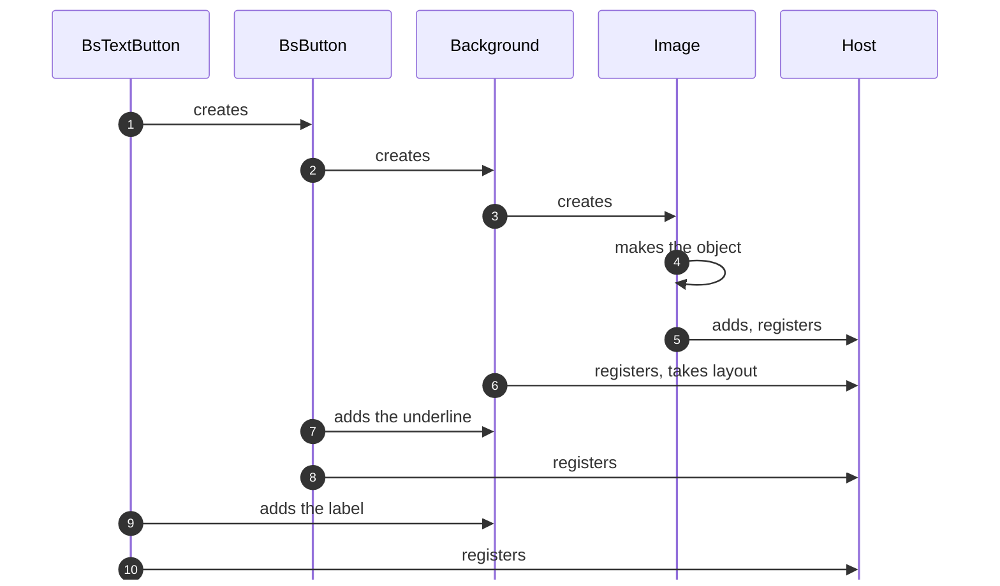

## The host

A component is a plain C# object, not a Unity behaviour. Once `Construct` returns, the component looks for a host on
the object it got, adds one if there isn't any, and registers itself with it. The host is Reactive's own behaviour on
that object, and it stays private, so you never deal with it directly. It passes Unity's lifecycle messages, like start,
update and destroy, to every component registered on it, in the order they registered. Enable and disable only reach
them when the object itself is turned on or off, not when a parent is. The host also runs the components' coroutines,
ticks their modules, and is what a parent's layout controller actually holds, measures and sizes.

This is the whole trick behind composition. `Construct` usually returns another component's object, like
`new Layout { ... }.Use()`, so the host is already there when your component looks for one. Your component joins that
host, gets the same lifecycle messages and lives on the same object, with no wrapper in the hierarchy. It stacks as deep
as you like, and a thin wrapper component really is thin, because composing costs no extra transforms.

Here's how a text button is built. Each component creates the next one while it's being constructed, so the innermost
one finishes first, makes the object and adds the host, and the others register on that host on the way back out:



Running `Construct` from the constructor matters too. The tree exists before any initializer runs on your component,
so a property can forward to something inside it and look no different from one the component owns. Modules you bind
before the host exists wait in a temporary set and move over once it's created, so the order you bind them in doesn't
matter either.

The host also covers a few cases you'd otherwise run into. Turning an object on or off inside a hidden hierarchy
doesn't reach Unity's enable message, so the host remembers it and lays the object out again once the hierarchy shows
up. A rect resized from outside the layout system marks the last applied size as stale, so the layout applies it again.
And when the object moves to another parent, the host forgets each component's cached canvas, since a pooled component
can end up under a different one.

## The layout component

Several components on one host raise a question. A parent's layout controller only ever deals with the host, so when
it asks how big the host is or hands it a size, one component has to answer for all of them. That component is the
host's **layout component**, and without one the host measures as empty and nothing lays out its children.

A component takes the role by calling `PromoteLayoutComponent(this)`, and when several do, the last call wins. You can
call it from `OnInstantiate` or from `OnInitialize`, and it reaches the host either way, because a call made before the
host exists waits and takes effect the moment the component registers. What decides the winner is the order components
register in, and an outer component always registers after everything it built. So `Layout` takes over from the
component it was built around, while a leaf like `Label` or `Image` keeps the role until a layout wraps it. When the
role moves, the previous holder is demoted and the parent measures the host again if anything about its size changed.
From then on, the host passes five calls to whoever holds the role:

- **`PromotedHasIntrinsicContent`** says whether measuring the host means anything. When it's false, a controller skips
  measuring and treats the host as empty.
- **`PromotedMeasure(width, widthMode, height, heightMode)`** answers a measure request with a size.
- **`PromotedApplyLayout(dimensions)`** runs after the host has applied its own dimensions to its rect, so a container
  can go on to apply its children's.
- **`PromotedRecalculateLayout()`** runs when the host is a root that needs recalculating.
- **`PromotedOnModifierUpdate()`** runs whenever the host's modifier changes or it leaves its parent. `Layout` only acts
  on it as a root, applying the modifier to its own tree, since no parent controller picks the change up.

Only `Layout`, `Label` and `Image` promote themselves, and every other component is built on top of one of them. A
button, a toggle or a slider never promotes, so its layout component is whatever sits at the bottom of what it built. In
the text button above, `Image` takes the role when it registers at step 5, `Background` takes it over at step 6, and
`BsButton` and `BsTextButton` register after that without touching it.

`Layout` forwards all five calls to its controller, and that's how a container works. A leaf overrides measuring
instead, and here's `Label` doing exactly that:

```csharp
protected override void OnInstantiate() {
    PromoteLayoutComponent(this);
}

protected override void Construct(RectTransform rect) {
    _text = rect.gameObject.AddComponent<TextMeshProUGUI>();
    _text.RegisterDirtyLayoutCallback(NotifyLayoutDataUpdated);
}

protected override bool PromotedHasIntrinsicContent => true;

protected override Vector2 PromotedMeasure(
    float width,
    MeasureMode widthMode,
    float height,
    MeasureMode heightMode
) {
    return LayoutTool.MeasureNode(
        preferredSize: _text.GetPreferredValues(),
        width: width,
        widthMode: widthMode,
        height: height,
        heightMode: heightMode
    );
}
```

`NotifyLayoutDataUpdated` is how a leaf tells its parent that its content changed size, so the parent lays it out
again, and TextMeshPro's dirty callback is wired straight to it. `Layout` does the same for a parent that measures it
instead of sharing its tree, whenever its controller or children change.

Two helpers from `LayoutTool` do the measuring work, so you don't handle each mode yourself. This snippet runs both on a
preferred size of 40 by 20:

```csharp
var preferred = new Vector2(40f, 20f);

// No constraints, so the preferred size comes back as it is
var natural = LayoutTool.MeasureNode(
    preferredSize: preferred,
    width: float.NaN,
    widthMode: MeasureMode.Undefined,
    height: float.NaN,
    heightMode: MeasureMode.Undefined
);

// An imposed width, and a height capped below the preferred one
var constrained = LayoutTool.MeasureNode(
    preferredSize: preferred,
    width: 30f,
    widthMode: MeasureMode.Exactly,
    height: 10f,
    heightMode: MeasureMode.AtMost
);

// The same width as a cap, with the height following the aspect ratio
var fitted = LayoutTool.FitPreservingAspect(
    size: preferred,
    width: 30f,
    widthMode: MeasureMode.AtMost,
    height: float.NaN,
    heightMode: MeasureMode.Undefined
);

Debug.Log($"{natural.x} x {natural.y}");         // 40 x 20
Debug.Log($"{constrained.x} x {constrained.y}"); // 30 x 10
Debug.Log($"{fitted.x} x {fitted.y}");           // 30 x 15
```

`MeasureNode` keeps the preferred size when an axis has no limit, uses the given size when one is imposed, and takes
the smaller of the two when it's only a cap. `FitPreservingAspect` scales the whole size instead, so capping the width
also shrinks the height and keeps the ratio. An image that preserves its aspect runs its preferred size through it first,
then hands the result to `MeasureNode`.

That's the recipe for any component that wraps something with a natural size: promote yourself, say you have intrinsic
content, measure it and notify when it changes.

Promotion is also why a component is a container or a leaf, never both. A background is a layout built around an
image, and as the text button showed, the layout takes over. From then on the image is only drawn, while the background
takes its size from its children and the image stretches to match. The same mechanism lets a wrapper take over layout
from what it wraps by promoting itself, and lets a component that doesn't care about layout leave it to whoever built
the tree.
