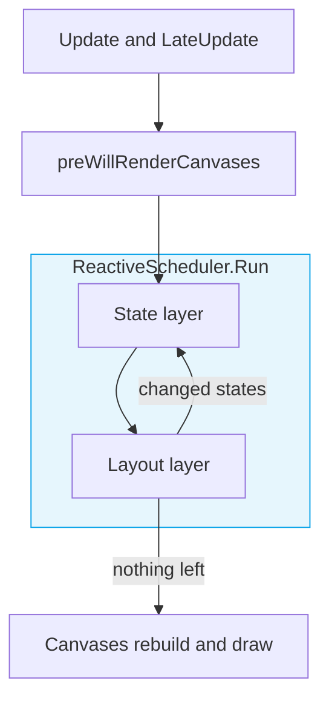
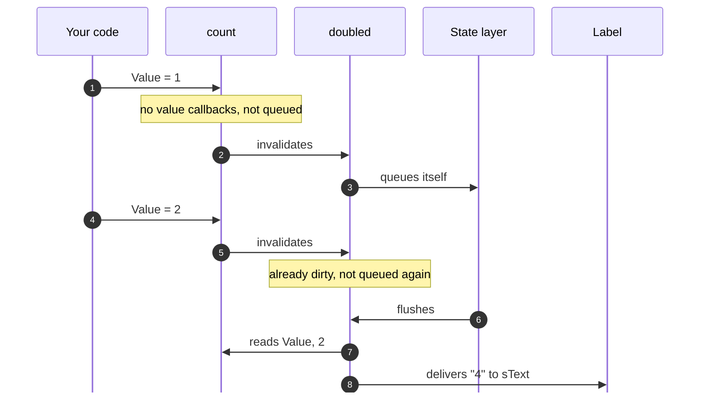
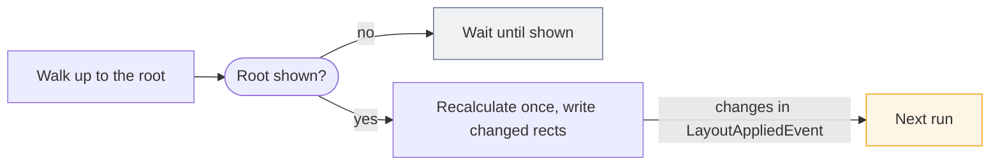

## Two layers, in order

Neither states nor layouts do their work at the moment something changes. A changed state and a changed layout are both
queued, and `ReactiveScheduler` drains the two queues once per frame. That one drain is where all batching comes from, so
ten writes to a state deliver one update and ten changes to a layout recalculate it once. The order you set things in
never matters either, because nothing is acted on until the end of the frame.

The scheduler hooks `Canvas.preWillRenderCanvases`, which Unity raises after every `LateUpdate` and right before it
rebuilds the UI canvases. Whatever changes during a frame, in `OnUpdate`, in a pointer handler, from a coroutine or by an
animation module, is therefore delivered and laid out before that same frame is drawn, without a frame of lag. The hook
is static and installed once, so there's nothing to add to a scene.

Inside the hook, two layers run in a fixed order. The **state layer** goes first: every dirty state computes its value
and runs its callbacks once, and bindings set their properties here. A property that affects layout, such as a `Size`,
a `Gap` or a label's text, marks its layout dirty as a side effect. A callback that writes another state gets that state
delivered in the same run, so cascades settle, and one that never settles is cut off after a hundred thousand flushes
with an error instead of hanging the game. The **layout layer** then runs on the settled values, recalculating every
layout that was marked dirty and applying the result to the rects. Here's where the two layers sit in a frame:



You might have noticed the loop from the layout layer back to the state layer. It comes into play when code reads
something the layout produced and writes it to a state, like this underline that takes its width from the label above it:

```csharp
var title = Remember("Settings");
var width = Remember(0f);

new Layout {
    FlexController = {
        FlexDirection = FlexDirection.Column,
        AlignItems = Align.Center,
        Gap = 1.pt
    },

    Children = {
        new Label {
            sText = title,

            // Runs in the layout layer, once the label has its size
            Do = x => x.LayoutAppliedEvent += _ => {
                width.Value = x.ContentTransform.rect.width;
            }
        },

        // Sized from that width before the frame is drawn
        new Background {
            FlexItem = {
                sSize = width.Map(x => new YogaVector(x.pt, 0.5f.pt))
            },

            Color = Color.white
        }
    }
}
```

The label's width only exists once the layout layer has run, so the handler changes a state in the middle of it. Instead
of leaving that change for the next frame, the scheduler goes back to the state layer, which gives the underline its new
size, and then lays it out again. The underline is therefore drawn at the right width in the same frame as a new title,
rather than a frame late at the old one. Something that keeps both layers busy forever is stopped after a hundred passes
with an error, and the rest waits for the next frame. `ReactiveScheduler.Run()` runs the whole loop on demand, and
calling it while a layer is running does nothing, so it's safe from inside a callback.

## Inside the state layer

A state has two kinds of subscribers, and the difference between them is what makes derived states cheap:

- **Invalidation callbacks** are told right away that the state changed, without a value. That's how `Map`, `Where` and
  `RememberDerived` learn that their cached value is stale without computing anything.
- **Value callbacks** are what bindings and `AddCallback` register, and the state layer delivers them later, with the
  value.

When a state changes, it walks its invalidation callbacks, which mark everything downstream stale, and each downstream
state walks its own in turn. Each state on the way that has value callbacks and isn't dirty yet marks itself dirty and
joins the queue. The walk is numbered, so a state reached twice through two paths from the same source passes the change
on once, and a diamond of derived states doesn't deliver twice. States without value callbacks never enter the queue,
so a state that's only ever read directly costs nothing per frame.

When the layer runs, each queued state flushes, and that's the first time a derived state actually computes. It reads
its sources as they are at that point, after every write of the frame has landed, so it never sees half an update. Take
a label bound to a derived state, with the source written twice in one frame:

```csharp
var count = Remember(0);
var doubled = count.Map(x => (x * 2).ToString());

var label = new Label {
    sText = doubled
};

// Later, in one frame
count.Value = 1;
count.Value = 2;
```

Here's what those two writes go through before the label shows "4":



## Inside the layout layer

Marking a layout dirty only puts its node in a queue. A node can't be recalculated on its own, though, because its size
depends on the parents that lay it out, so the layer walks up from each queued node to its **root**, the first node
above it that nothing lays out. A walk stops at a node that an earlier walk already passed, so all the dirty nodes of
one tree lead to a single recalculation of its root.

That recalculation runs the layout engine over the whole tree, within the rect the root is attached to, and hands the
results down, where each node writes its rect only if it changed. A hidden root is skipped until it's shown, and changes
made in a `LayoutAppliedEvent` handler wait for the next run, so a pass never changes under itself. [Layout Engine
Internals](/docs/reactive/under-the-hood/layout) covers what recalculating a tree involves, and the whole path looks
like this:



You rarely need to mark a layout dirty yourself, since anything that affects it does that already:

- A controller or modifier property changes, or the controller is swapped.
- A child is added or removed, or enabled, disabled or ignored.
- A leaf's content changes size.
- A component is shown after something changed while it was hidden.
- A root's rect is resized from outside the layout system.

When you do need it, call `NotifyLayoutDataUpdated()` on the component that changed, the same way labels and images
notify their parent when their content changes size. Always leave the rest to the scheduler instead of recalculating
layouts your own way, because only the scheduler's pass runs once per frame, after the states it reads have settled. If
you need a layout of your own, see [Your own Layout Controller](/docs/reactive/layout/custom).
